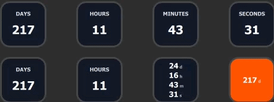
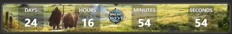
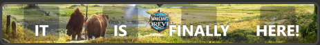
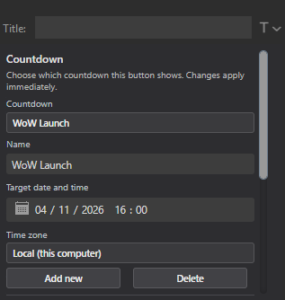
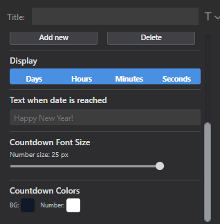

# Date Countdown

A Stream Deck plugin that shows a live countdown to a date and time you choose.

## Features

- Live countdown to a custom date and time
- Multiple saved countdowns
- Per-countdown time zone support
- Choose what to display:
  - Days
  - Hours
  - Minutes
  - Seconds
  - Any combination of those
- Stack selected units vertically for a cleaner layout
- Custom text when the countdown reaches zero
- Works with both keypad buttons and dials

## How to use

1. Add a Date Countdown action to a button or dial.
2. Open the property inspector.
3. Select or create a countdown.
4. Set:
   - the name
   - the target date and time
   - the time zone
   - the units you want to display
   - optional custom text for when the countdown is reached

## Countdown actions

The plugin includes five actions:
- Days
- Hours
- Minutes
- Seconds
- Countdown

The first four are simple single-unit actions.

The **Countdown** action is the flexible one. It lets you select any combination of days, hours, minutes, and seconds.

Examples:
- Days only → `120d`
- Minutes only → `6m`
- Days + Hours → `120d` and `5h`
- All units → `120d`, `5h`, `6m`, `30s`

## Time zones

Each countdown can use its own time zone.

This is useful when you want the countdown to match a specific location, such as:
- your local time
- a conference time zone
- a launch time in another country

## Reached text

You can also set a custom message that appears when the countdown reaches zero, for example:
- `Happy New Year!`
- `It’s here!`
- `Launch day!`

If left empty, the countdown simply shows zero.

## Notes

- Existing countdowns without a time zone still work and use the local time zone.
- The legacy single-unit actions still behave as before.
- If you want multiple units in one display, use the **Countdown** action.

## Examples

  

  

Message when completed:

Settings:

[Buy me a beer](https://buymeacoffee.com/LVercauteren)
